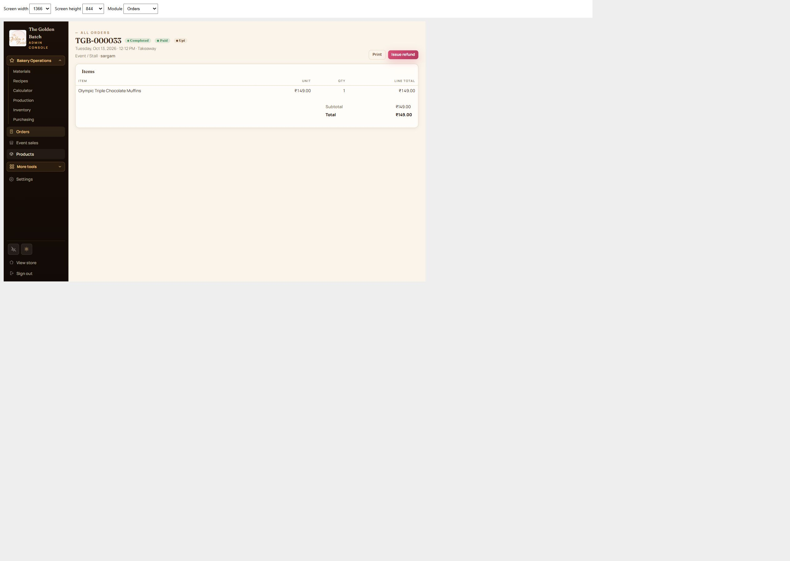

Responsive layout checks completed for Recipes, Orders, and Event / Stall.

The event report no longer pins the first and last columns. Phone and tablet reports show labeled cards, keeping all totals and actions readable. Laptop reports keep the full table in a scrollable area. Prepared-product fields, order filters, payment actions, recipe ingredients, and help tooltips fit within the screen.

| View | Widths checked |
| --- | --- |
| Event report and preparation form | 320, 375, 390, 430, 600, 768, 820, 1024, 1366, 1440 px |
| Order list and add-order form | 320, 375, 390, 430, 600, 768, 820, 1024, 1366, 1440 px |
| Recipe cards and add-recipe editor | 320, 375, 390, 430, 600, 768, 820, 1024, 1366, 1440 px |
| Order detail | 320, 390, 768, 820, 1024, 1366 px |
| Order form heights | 390 × 667, 820 × 1180, 1366 × 768 px |

All 69 final browser checks passed: no page overflow, no controls outside the screen except those intentionally inside scrollable desktop tables, and no pinned event columns. The production build passed. Browser previews use the existing local data; no orders, recipes, or events were saved or deleted during these checks. These are Chrome layout checks rather than physical-device Safari tests.

Detailed measurements: [checks.json](checks.json).

Laptop order detail preview:

